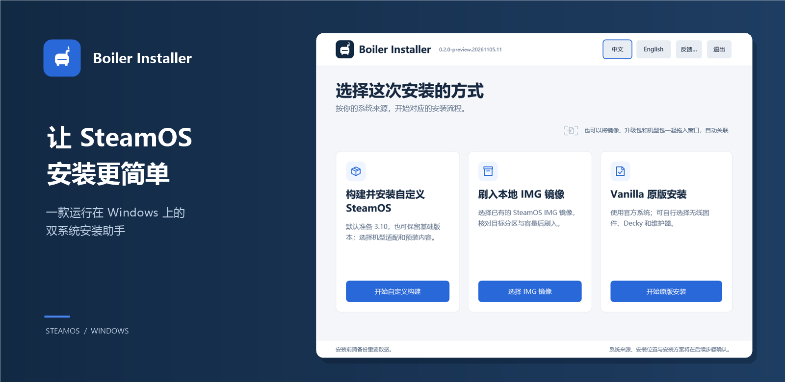

# Boiler Installer



<p align="center">
  <strong>Make installing SteamOS easier.</strong><br>
  Install a SteamOS / Windows dual-boot setup directly from Windows, without a USB drive.
</p>

<p align="center">
  <a href="README.md">简体中文</a> · English<br><br>
  <a href="https://github.com/FlightDan/Boiler-installer/releases"><strong>Download</strong></a>
  &nbsp; · &nbsp;
  <a href="docs/install/README.md">Installation guide (Chinese)</a>
  &nbsp; · &nbsp;
  <a href="https://github.com/FlightDan/Boiler-adaptations">Device adaptations</a>
</p>

<sub>The image uses a local 0.2.0-preview.20261105.11 UI preview; the interface may vary between versions.</sub>

## 1. About

Boiler Installer is a Windows assistant for preparing and installing SteamOS. Choose an official system or an existing image, select a destination and available components, then review your plan before installing.

Browse the [Boiler adaptations repository](https://github.com/FlightDan/Boiler-adaptations) for device support, its validation status, and ways to contribute.

The current source version is **0.2.2 preview**. See the relevant [Release](https://github.com/FlightDan/Boiler-installer/releases) for available downloads, known issues, and validation scope.

## 2. Features

### Install a system

| Method | Use |
| --- | --- |
| Build and install custom SteamOS | Start from the official recovery image, choose device support and components, and optionally select the offered system upgrade. |
| Flash a local IMG | Install an existing SteamOS disk image or Boiler image package after checking the source and target space. |
| Vanilla installation | Start from the official system without device scripts, with available generic components as options. |

### Choose installation content

Select an available device package or import a trusted local one, and review its available components. The custom components page can also read hardware identifiers from the current Windows computer; it cannot identify the computer that owns an external target disk.

### Review and install

Select a system source, disk, and installation space, then review the plan and follow progress and logs. New SteamOS partitions in the selected range will be formatted. Deleting or formatting other partitions may happen separately before installation; back up data and review each confirmation.

### Set up boot

Depending on the installation, you can choose an rEFInd dual-boot menu and its settings. For an internal disk you can also choose whether to set a default firmware boot entry. Follow the device and installer instructions for external boot.

## 3. Download and install

**[Get the Windows installer from GitHub Releases](https://github.com/FlightDan/Boiler-installer/releases)**

Download the Windows x64 installer ZIP from the release assets, extract it completely, and run `BoilerInstaller.exe`. GitHub Release slim installers do not bundle device packages. Acquire a compatible package through an available trusted source in the installer, or import a trusted local package. SteamOS images are obtained separately or through the installer.

Back up important data, prepare enough contiguous unallocated target space and a separate workspace, and save your BitLocker or device-encryption recovery key before following the Secure Boot instructions.

1. Choose an installation method and device support.
2. Prepare the system source, workspace, and destination.
3. Review available components and boot settings.
4. Check the disk, partition range, and plan before starting.

The [detailed installation guide](docs/install/README.md) is currently in Chinese.

## 4. Help and feedback

- [Documentation index](docs/INDEX.md)
- [Report an installer issue](https://github.com/FlightDan/Boiler-installer/issues)
- [Request support for another model](https://github.com/FlightDan/Boiler-adaptations/issues): include its brand, model, and the support you need.
- [Contribute a device adaptation](https://github.com/FlightDan/Boiler-adaptations): follow that repository's contribution instructions and include the device, system and kernel versions, and test evidence.

<details>
<summary>Issue report template</summary>

Check existing issues first. Remove passwords, recovery keys, tokens, and personal information from screenshots and logs before sharing.

```text
Problem:
Device brand / model:
Windows version:
Installer version:
Installation method / system source:
Device package and version (if applicable):
Steps to reproduce:
Expected result:
Actual result / error:
Screenshots or logs:
```

</details>

## 5. Development

See the [development and build guide (Chinese)](docs/DEVELOPMENT.md) for dependencies, build and test entry points. Author device adaptations in [Boiler-adaptations](https://github.com/FlightDan/Boiler-adaptations).

## 6. Roadmap

- [ ] Performance improvements
- [ ] Better ways to build and share device packages

## 7. License

Unless otherwise stated, original code and documentation in this repository are licensed under [GNU AGPL-3.0-only](LICENSE). Third-party code, firmware, and other components retain their own licenses; see [third-party notices](THIRD_PARTY_NOTICES.md).

## 8. Acknowledgements

Thanks to these projects and their contributors:

- **Device adaptations:** Thanks to the manufacturers and developers who contributed adaptations and testing to [Boiler Adaptations](https://github.com/FlightDan/Boiler-adaptations).
- **System and runtime:** [SteamOS](https://store.steampowered.com/steamos/), [QEMU](https://www.qemu.org/), [Alpine Linux](https://alpinelinux.org/), [.NET](https://dotnet.microsoft.com/), and [Python](https://www.python.org/).
- **Downloads and image processing:** [aria2](https://github.com/aria2/aria2), [desync](https://github.com/folbricht/desync), and [7-Zip](https://www.7-zip.org/).
- **Boot and optional components:** [rEFInd](https://www.rodsbooks.com/refind/), [UsbXbox360Dxe](https://github.com/jlobue10/UsbXbox360Dxe), [Decky Loader](https://github.com/SteamDeckHomebrew/decky-loader), and [linux-firmware](https://gitlab.com/kernel-firmware/linux-firmware).

Thanks also to everyone providing testing and feedback. See [third-party notices](THIRD_PARTY_NOTICES.md) for component sources and licenses.

SteamOS and Steam are trademarks of their respective owners. This community project is not affiliated with Valve.
