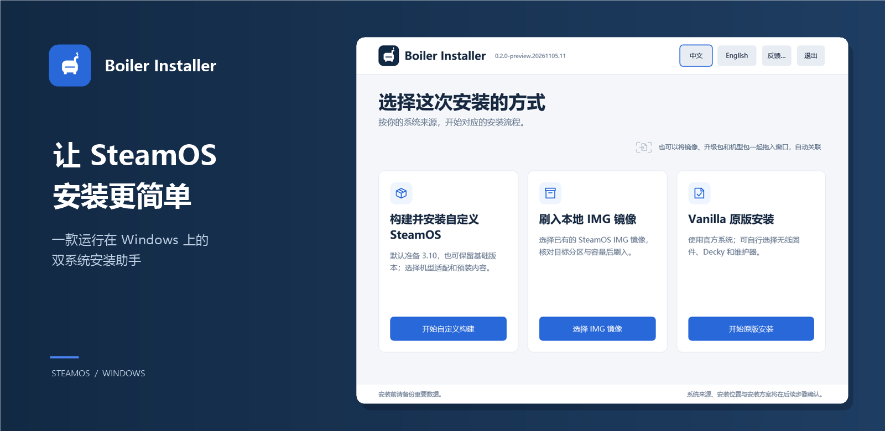
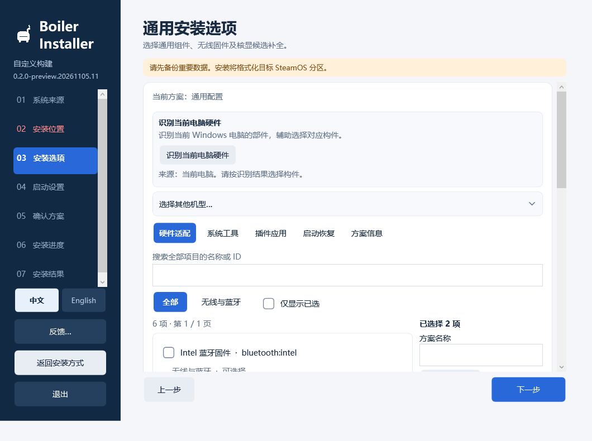
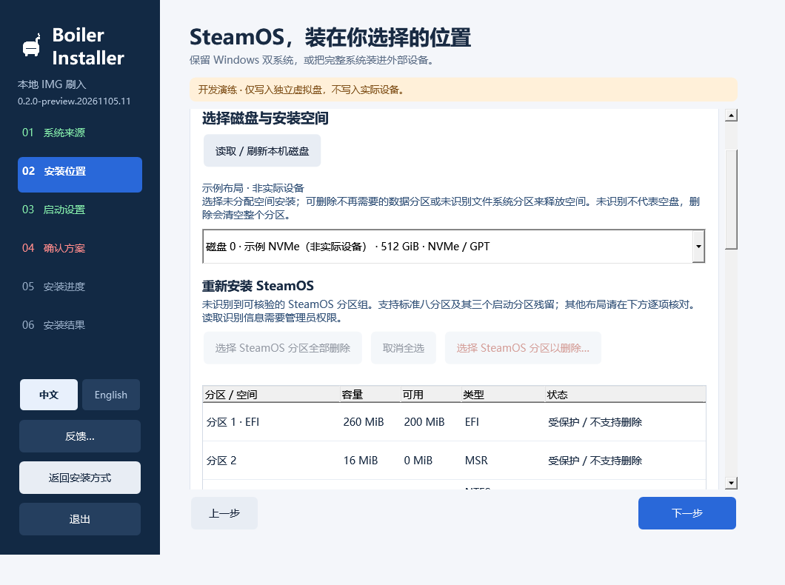

# Boiler Installer



<p align="center">
  <strong>让 SteamOS 安装更简单。</strong><br>
  免 U 盘，直接在 Windows 中安装 SteamOS / Windows 双系统。
</p>

<p align="center">
  简体中文 · <a href="README.en.md">English</a><br><br>
  <a href="https://github.com/FlightDan/Boiler-installer/releases"><strong>下载安装器</strong></a>
  &nbsp; · &nbsp;
  <a href="docs/install/README.md">安装指南</a>
  &nbsp; · &nbsp;
  <a href="https://github.com/FlightDan/Boiler-adaptations">机型适配</a>
</p>

<sub>展示图使用本地 0.2.0-preview.20261105.11 界面预览；不同版本的界面可能有所调整。</sub>

## 1. 简介

Boiler Installer 是一款运行在 Windows 上的 SteamOS 安装助手。你可以选择官方系统或已有镜像，按向导选择安装位置和需要的内容，再核对方案开始安装。

想了解有哪些机型适配、适配到什么程度，或参与新机型适配，请访问 [Boiler 机型适配仓库](https://github.com/FlightDan/Boiler-adaptations)。

当前源码版本为 **0.2.2 preview**。下载版本、已验证范围和已知问题请以 [Releases](https://github.com/FlightDan/Boiler-installer/releases) 中对应版本的说明为准。

## 2. 功能介绍

### 安装系统

| 安装方式 | 适合什么情况 |
| --- | --- |
| 构建并安装自定义 SteamOS | 使用官方恢复镜像，选择机型适配和安装内容；可选择是否升级到所提供的 SteamOS 版本。 |
| 刷入本地 IMG 镜像 | 使用已有的 SteamOS 磁盘镜像或 Boiler 镜像包；安装前会检查来源与目标空间。 |
| Vanilla 原版安装 | 从官方系统开始，不加载机型脚本；可按需选择可用的通用组件。 |

### 选择安装内容

- **机型适配**：从可用目录选择机型，或导入本地机型包；具体内容与适用范围以机型包为准。
- **可选组件与自定义构件**：按需查看和选择可用组件；机型包声明的可安装项目会按其默认设置选中，也可以取消。
- **部件识别**：在自定义构件页面只读识别当前 Windows 电脑的硬件，辅助查看匹配情况。它不能识别外接目标盘所属设备的硬件。

### 安装过程

选择系统来源、磁盘和安装空间后，可查看安装方案、进度与日志。安装会格式化目标范围中新建的 SteamOS 分区；删除或格式化其他分区也可能在安装前单独执行，请先备份并逐项确认。

### 启动设置

可按安装方式选择 rEFInd 双系统启动菜单及相关设置。内置硬盘安装可选择是否设置默认启动项；外部设备的启动方式以设备和安装器提示为准。

<details>
<summary>查看安装界面</summary>





以上为本地界面预览，磁盘和分区数据为示例，不代表已执行安装。

</details>

## 3. 下载与安装

**[前往 GitHub Releases 下载安装器](https://github.com/FlightDan/Boiler-installer/releases)**

在对应版本的 Assets 中选择 Windows x64 安装器 ZIP，完整解压后运行其中的 `BoilerInstaller.exe`。GitHub Release 的 slim 安装器不内置机型包；需要机型适配时，请通过安装器中可用的可信来源获取，或导入可信的本地包。SteamOS 系统镜像也需另行准备或按界面提示下载。

安装前请备份重要数据，确认目标磁盘上有足够的连续未分配空间，并为系统准备和下载预留工作空间。如果启用了 BitLocker 或设备加密，先保存并确认恢复密钥可用，再按安装器提示暂停保护、处理安全启动设置。

1. 选择安装方式，以及需要的机型适配。
2. 准备系统来源，选择工作空间与安装位置。
3. 按需选择安装内容和启动设置。
4. 核对目标磁盘、分区范围与选项，确认后开始安装。

**[查看详细安装指南 →](docs/install/README.md)**

## 4. 帮助与反馈

- [详细安装指南](docs/install/README.md) · [全部文档](docs/INDEX.md)
- 安装器问题或建议：[提交 Issue](https://github.com/FlightDan/Boiler-installer/issues)
- 申请更多机型：[在适配仓库提出 Issue](https://github.com/FlightDan/Boiler-adaptations/issues)，请写明品牌、型号和希望支持的内容。
- 提交机型适配：参照[适配仓库的贡献说明](https://github.com/FlightDan/Boiler-adaptations)，提供机型、系统、内核版本和测试记录，然后在该仓库提交 Pull Request。

<details>
<summary>展开问题反馈模板</summary>

提交前请先查看已有 Issue；一个 Issue 尽量只报告一个问题。分享截图或日志前，请移除密码、恢复密钥、令牌和个人信息。

```text
问题描述：
设备品牌 / 型号：
Windows 版本：
安装器版本：
安装方式 / 系统来源：
机型包及版本（如适用）：
操作步骤：
预期结果：
实际结果 / 报错：
截图或日志：
```

</details>

## 5. 开发与构建

项目源码包含 Windows 安装器、系统准备流程、包校验和通用组件。开发环境、依赖准备、构建与测试方法见 [开发与构建指南](docs/DEVELOPMENT.md)；机型适配源码请在 [Boiler-adaptations](https://github.com/FlightDan/Boiler-adaptations) 维护。

## 6. 路线图

- [ ] 性能改进
- [ ] 更好的机型包构建与分享方式

## 7. 许可证

除另有说明外，本仓库原创代码与文档采用 [GNU AGPL-3.0-only](LICENSE)。第三方代码、固件及其他组件保留各自的许可证，详见[第三方声明](THIRD_PARTY_NOTICES.md)。

## 8. 致谢

感谢以下项目及其贡献者：

- **机型适配**：感谢为 [Boiler Adaptations](https://github.com/FlightDan/Boiler-adaptations) 仓库提供适配和测试的厂商与开发者们。
- **系统与运行环境**：[SteamOS](https://store.steampowered.com/steamos/)、[QEMU](https://www.qemu.org/)、[Alpine Linux](https://alpinelinux.org/)、[.NET](https://dotnet.microsoft.com/) 和 [Python](https://www.python.org/)。
- **下载与镜像处理**：[aria2](https://github.com/aria2/aria2)、[desync](https://github.com/folbricht/desync) 和 [7-Zip](https://www.7-zip.org/)。
- **启动与可选组件**：[rEFInd](https://www.rodsbooks.com/refind/)、[UsbXbox360Dxe](https://github.com/jlobue10/UsbXbox360Dxe)、[Decky Loader](https://github.com/SteamDeckHomebrew/decky-loader) 和 [linux-firmware](https://gitlab.com/kernel-firmware/linux-firmware)。

也感谢提供测试与反馈的用户。各第三方组件的来源和许可说明见[第三方声明](THIRD_PARTY_NOTICES.md)。

SteamOS 和 Steam 为其各自权利人的商标；本项目为社区项目，与 Valve 无官方隶属关系。
