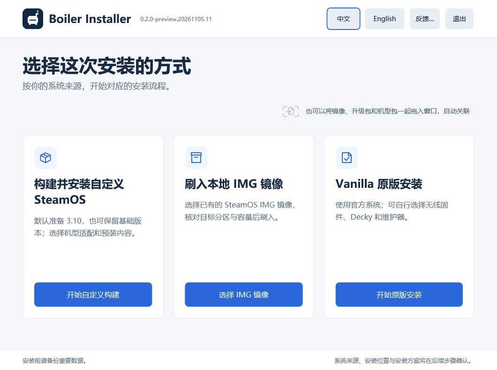
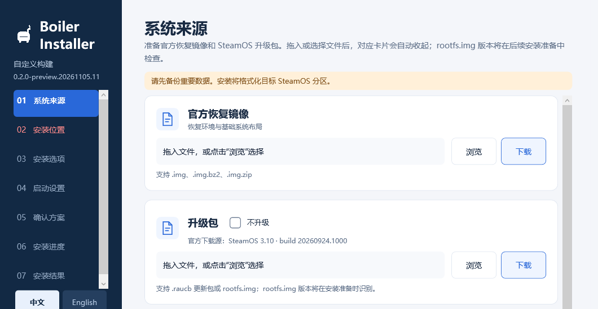
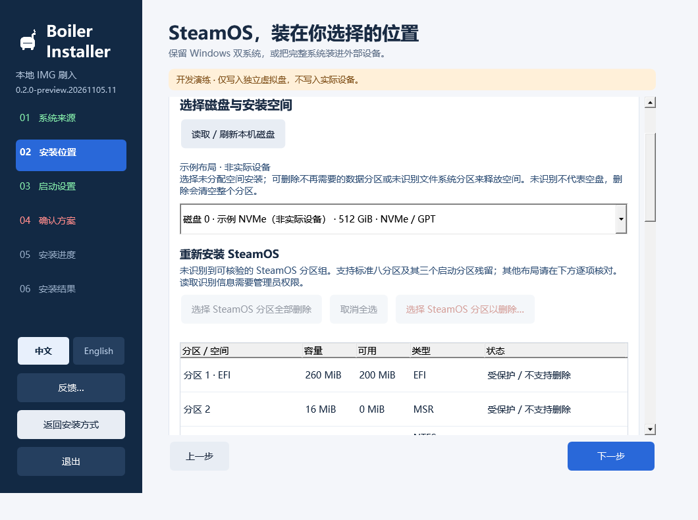
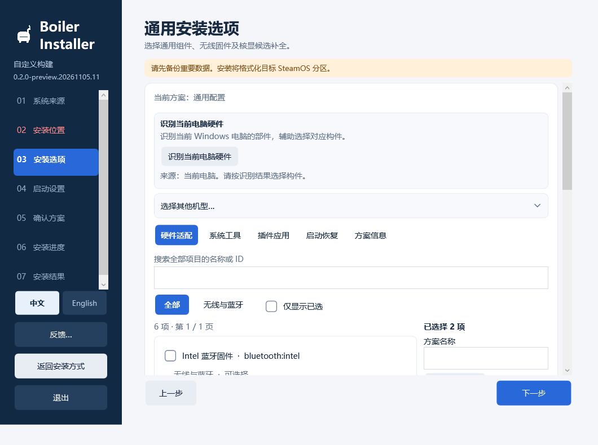
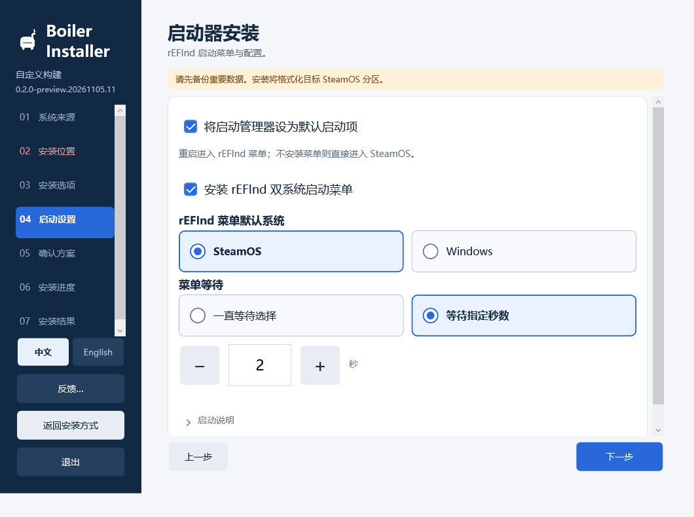
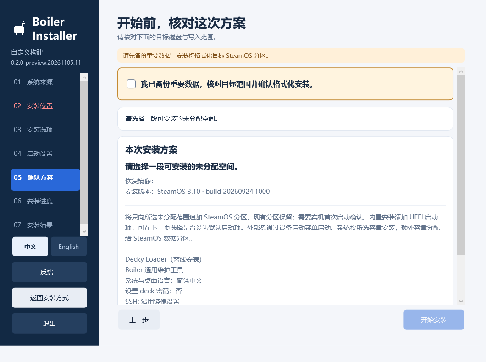
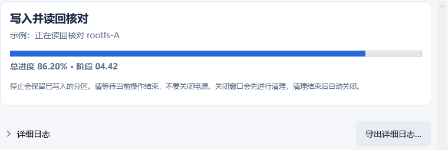

# Boiler Installer 安装指南

[返回项目首页](../../README.md) · [下载 Windows 安装器](https://github.com/FlightDan/Boiler-installer/releases) · [查看机型适配](https://github.com/FlightDan/Boiler-adaptations)

本指南介绍从 Windows 准备和安装 SteamOS 的流程。请先读完安装前准备，再按照自己使用的安装器版本和机型包提示操作。

> 当前源码版本为 0.2.1 preview。本页截图来自本地 0.2.0-preview.20261105.11 界面预览，部分画面经过裁切；示例磁盘、分区和进度用于说明，未执行真实安装。公开版本的界面、选项及验证范围请以对应 Release 为准。

## 目录

1. [安装前准备](#1-安装前准备)
2. [下载并启动安装器](#2-下载并启动安装器)
3. [选择安装方式](#3-选择安装方式)
4. [选择机型适配](#4-选择机型适配)
5. [准备系统来源与工作空间](#5-准备系统来源与工作空间)
6. [选择安装位置](#6-选择安装位置)
7. [选择安装内容](#7-选择安装内容)
8. [选择启动设置](#8-选择启动设置)
9. [确认方案并安装](#9-确认方案并安装)
10. [安装完成或遇到问题](#10-安装完成或遇到问题)

## 1. 安装前准备

### 备份与启动设置

1. **备份重要数据。**确认备份可以读取，并辨认目标磁盘。安装会在所选范围创建和格式化 SteamOS 分区；自行删除或格式化分区会清除其中的数据。
2. 如果启用了 **BitLocker 或 Windows 设备加密**，先备份并确认恢复密钥可用，再暂停保护。关闭安全启动或调整启动顺序可能使 Windows 要求输入恢复密钥。
3. 在 BIOS / UEFI 中关闭 **Secure Boot（安全启动）**，然后返回 Windows。安装器会检查状态，但不会代你修改 BIOS 设置或暂停加密保护。
4. 安装完成并确认 Windows 可以正常启动后，恢复 BitLocker 保护。

### 设备和空间

- 使用以 UEFI 启动的 **Windows x64** 电脑，并允许安装器按提示取得管理员权限。
- 当前向导要求目标磁盘上有至少 **128 GiB 连续未分配空间**，可选择的 SteamOS 安装容量为 128 或 256 GiB。磁盘还必须符合界面中的 GPT、设备和保护检查；本地镜像也必须能放入所选空间。
- 另选一个有充足空间的**工作空间**，用于下载、解压和准备系统。自定义安装界面提示至少 45 GiB、建议 64 GiB；镜像展开、安装副本、旧任务和额外下载可能需要更多空间，实际以安装器提示为准。
- 准备可用的网络连接，或事先取得安装所需的官方系统镜像、升级包和机型包。具体来源取决于选择的安装方式。
- 如果准备装到外接 SD 卡或 SSD，确认设备连接可靠，并检查目标设备的启动支持及对应 Release 的验证范围。

**未分配空间**不是文件夹内的剩余空间。安装器只接受符合检查的目标范围；它不会因为选择了某个磁盘，就把该磁盘上的所有数据都视为可覆盖。

## 2. 下载并启动安装器

1. 打开 [GitHub Releases](https://github.com/FlightDan/Boiler-installer/releases)，阅读准备使用的版本说明。
2. 在该版本的 **Assets** 中下载 Windows x64 安装器 ZIP。不要把自动生成的 Source code 压缩包当作可直接运行的安装器。
3. 将 ZIP **完整解压到一个文件夹**，保留其中的文件和目录，然后运行 `BoilerInstaller.exe`。按 Windows 和安装器提示处理权限。
4. 选择安装方式，并按出现的提示确认已完成安全启动和加密准备。

GitHub Release 的 **slim** 安装器不内置机型包。机型目录中的介绍或适配指南也不等于已经提供可安装载荷：请查看安装器中实际可用的来源，或准备可信的本地机型包。SteamOS 系统镜像不随安装器提供。

## 3. 选择安装方式

| 方式 | 说明 |
| --- | --- |
| **构建并安装自定义 SteamOS** | 使用官方恢复镜像，选择机型适配和可用组件。可选择使用界面提供的升级包，或不升级。 |
| **刷入本地 IMG 镜像** | 安装已有的 SteamOS IMG 或 Boiler 镜像包。完整 A/B 镜像中的系统、软件和用户数据会随镜像保留；此流程不再选择机型组件。 |
| **Vanilla 原版安装** | 使用官方系统，不加载机型脚本；可按需选择界面中可用的通用组件。 |

本地 IMG 或镜像包必须来自可信来源，并符合安装器的检查要求。不同镜像的系统版本、内容、容量和兼容性可能不同；选择前先阅读镜像提供者的说明。

## 4. 选择机型适配

自定义构建会先进入设备适配页面。选择以下方式之一：

- **选择机型**：选择目标设备对应的机型包，并查看来源、内容和兼容性说明。目录能显示某台机型，并不表示该版本一定能下载或安装对应机型包。
- **导入本地机型包**：在普通安装界面选择或拖入已有包，按提示检查来源、内容及本次信任。只导入和检查不会执行包内脚本；安装时才会按所选方案处理。
- **通用安装**：不加载机型脚本，继续使用可用的通用选项。没有机型适配时，设备的部分功能可能无法正常工作。

机型包声明且当前可安装的项目按该包的默认设置选中；你可以逐项取消。请留意项目注明的设备匹配条件、不兼容原因和不可用状态。

安装器的“识别当前电脑硬件”读取的是**运行 Windows 安装器的这台电脑**，不会识别外接磁盘将来装在哪台掌机里。它提供硬件标识与匹配线索，不代表 Linux 驱动或休眠等功能已经通过实机验证。

## 5. 准备系统来源与工作空间

### 自定义或 Vanilla 安装

1. 在**官方恢复镜像**卡片选择已下载的文件，或使用界面提供的下载入口。
2. 自定义构建默认选择升级到界面提供的 SteamOS 版本；如保留这一选择，按提示提供对应升级包或系统文件，不需要升级时可勾选“不升级”。Vanilla 流程的默认选择以界面为准。
3. 在**工作空间**处选择有足够可用空间的本地文件夹。下载、展开和安装副本会占用该空间；请参考实时空间提示。
4. 等待所选来源完成检查，再继续。

### 本地 IMG 安装

选择已有的完整 SteamOS 磁盘镜像或 Boiler 镜像包。支持的格式和来源会显示在文件选择界面；工作空间的需求随镜像大小、压缩格式和安装副本变化。检查通过后继续选择目标位置。

## 6. 选择安装位置

1. 选择内置硬盘双系统，或外部 SD 卡 / SSD 方案。
2. 点击**读取 / 刷新本机磁盘**，根据型号、容量和连接方式找到目标磁盘。
3. 选择符合条件的连续未分配空间和安装容量，检查界面显示的分区变化。
4. 如果找不到合适的空间，先确认磁盘布局、容量和保护状态。不要仅凭磁盘编号判断目标。

**请特别注意：**删除数据分区、删除可识别的旧 SteamOS 分区或格式化剩余空间等操作有各自的确认流程，确认后可能立即改变磁盘，而不是等到最后点击“开始安装”才执行。受保护或无法确认归属的分区不能因此视为可删除；不确定时请停止并先核对备份及目标。

## 7. 选择安装内容

自定义和 Vanilla 流程会显示适用于当前方案的选项。查看各项说明、可用状态与默认选择，取消不需要的项目；实际选项会因安装器版本、机型包和系统来源而不同。

部件识别仅供辅助，不能替代机型包所要求的目标设备匹配。不可用或不兼容的项目请按界面提示处理，不要仅因为目录中有名称就认为载荷已经就绪。

本地 IMG 安装沿用镜像已有内容，不经过此选择页面。

## 8. 选择启动设置

根据需要查看 rEFInd 双系统启动菜单、菜单默认系统和等待时间等选项。内置硬盘安装可选择是否将安装的启动管理器设为默认 UEFI 启动项；外部设备通常通过设备的启动菜单选择。

更改启动顺序前，请再次确认已保存加密恢复密钥。不同设备的固件菜单和操作方式不同，具体支持情况以设备及 Release 说明为准。

## 9. 确认方案并安装

在**确认方案**页面逐项检查：

- 目标磁盘的型号、容量，以及将要写入的未分配范围；
- 系统来源、版本、机型包和已选组件；
- 计划新建和格式化的分区，以及启动设置。

如果任何一项不符合预期，返回对应页面修改。确认备份和目标无误后，按界面要求勾选确认并开始安装。安装期间保持供电与设备连接，等待准备、写入和核对完成。

进度图仅为界面示例。停止或中断后，已经写入的分区可能保留；请等待安装器结束当前操作和清理，不要直接断电。

## 10. 安装完成或遇到问题

### 安装完成后

1. 阅读安装结果和提示。按需从设备的启动菜单选择 SteamOS，或使用已安装的启动菜单。
2. 首次启动后检查系统能否进入，以及适配包说明中与你设备有关的按键、网络等功能。
3. 确认 Windows 可以正常启动后，恢复之前暂停的 BitLocker 保护。

### 无法继续或安装中断

- 先阅读当前错误、结果页面和详细日志；不要把中断当作安装成功。
- 如果目标磁盘身份、分区状态或恢复状态不明确，先停止操作，保留任务记录和工作空间，不要反复覆盖安装。
- 下载或机型包不可用时，检查网络、包来源、兼容性和对应 Release 说明。目录中的指南不等于可安装包。
- 仍无法解决时，在 [安装器 Issues](https://github.com/FlightDan/Boiler-installer/issues) 说明安装器版本、机型、步骤、报错和日志。分享前移除密码、恢复密钥、令牌与个人信息。

更多机型适配的申请与贡献，请前往 [Boiler 适配仓库](https://github.com/FlightDan/Boiler-adaptations)。
